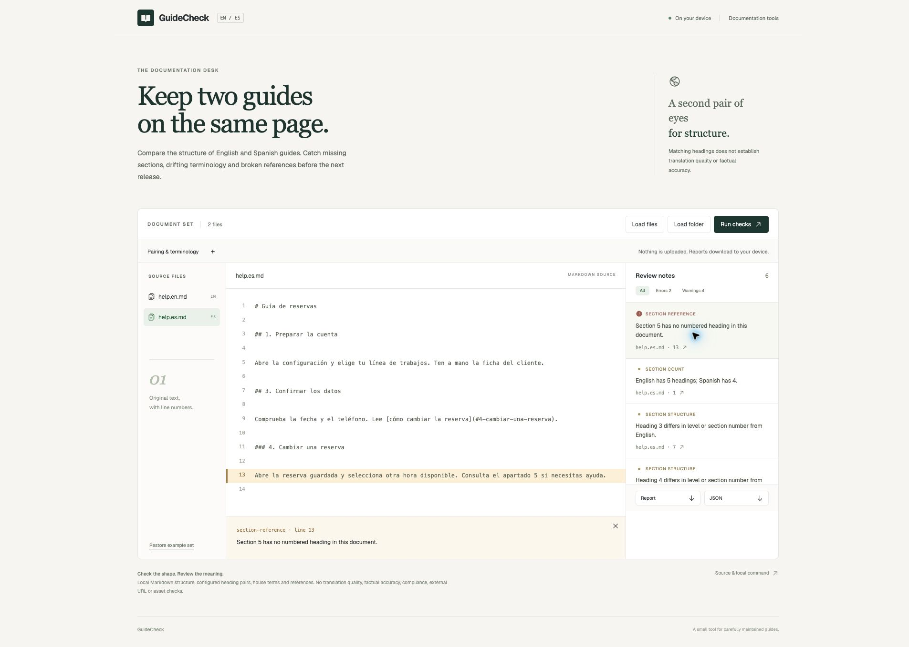

# GuideCheck

A local workspace for checking the structure of paired English and Spanish Markdown guides.

A translated guide can have the right number of headings and still miss the booking instructions. GuideCheck lets you name the sections that must exist in both editions, then checks their order, numbering, terminology and references. Each finding opens the original source at its line number.



[Open the workspace](https://stigmavlc.github.io/guidecheck/) · [Checks and limits](docs/checks.md) · [How it works](docs/architecture.md)

## Try the example

The workspace starts with two synthetic booking guides. The Spanish edition is missing a section, uses an old house term and points to a section that does not exist. Select a review note to inspect its source. Use Errors or Warnings to narrow the list, then download the report as Markdown or JSON.

The documents are examples, not customer records. A corrected pair is in `examples/good`; the original deliberately broken pair is in `examples/broken`.

## Check your own guides

1. Choose **Load files**, or **Load folder** when links depend on a directory structure. Only `.md` files are supported.
2. Open **Pairing & terminology**. Files ending in `.en.md` and `.es.md` are paired automatically, but translated headings must be mapped explicitly.
3. Review or edit the configuration and choose **Run checks**.
4. Select a finding to see the source line. Fix the original file in your editor, then load the changed set and run the checks again.
5. Download the report and configuration if you need to keep them. Closing or reloading the page discards the loaded set.

Tab reaches the controls. Arrow keys, Home and End move between document tabs. The source panel can be focused and scrolled from the keyboard. Reduced motion preferences are respected.

## Run locally

Use Node.js 22.22 or later and npm. From a fresh clone:

```sh
git clone https://github.com/Stigmavlc/guidecheck.git
cd guidecheck
npm ci
npm run dev
```

Open the local `/guidecheck/` address printed by Vite. The application works without a backend. A production build is written to `dist` by `npm run build`.

## Use the local command

```sh
npm run check -- examples/good --config examples/guidecheck.json
npm run check -- examples/broken --config examples/guidecheck.json --format json
npm run check -- path/to/guides --config guidecheck.json --output report.md
```

The first example returns exit code 0. The broken example returns 1 because it contains errors. Use a new output filename: the command refuses to overwrite a document, existing report or symbolic link.

| Exit code | Meaning |
| --- | --- |
| 0 | Checks finished with no errors. Warnings may still need review. |
| 1 | Checks finished and found at least one error. |
| 2 | Invalid input, configuration or output destination. |

Without `--config`, the command infers language pairs from filenames. It cannot infer the translation of a heading. Run `npm run check -- --help` for the options.

## Configuration

```json
{
  "pairs": [{
    "en": "help.en.md",
    "es": "help.es.md",
    "sections": [
      {"en": "1. Prepare your account", "es": "1. Preparar la cuenta"},
      {"en": "2. Create a booking", "es": "2. Crear una reserva"}
    ]
  }],
  "glossary": [{
    "language": "es",
    "preferred": "cola de trabajos",
    "avoid": ["línea de trabajos"]
  }]
}
```

Paths are relative to the loaded document set and case sensitive. Section names match heading text exactly, including numbering. Their order in the configuration is the expected order in each edition. Glossary matching is case insensitive and uses word boundaries. It applies only to documents in language pairs and excludes code spans and fenced code.

## Privacy and scope

Documents are read into memory on your device. The browser app has no document upload endpoint, telemetry or persistent document storage. It renders source as text rather than executing imported HTML. Report downloads contain the original documents in JSON, and source excerpts in Markdown, so review a report before sharing it. The local command writes only the output you request.

The hosted page and its assets still pass through GitHub Pages like any website. Use the local build when your organisation requires offline operation. Input is limited to 100 documents, 200,000 bytes per document and 1,000,000 bytes in total. Configuration is limited to 200,000 bytes. The command skips hidden entries and `node_modules`, refuses symbolic links and stops beyond 15 nested folders.

A clean result establishes only that the configured checks passed. It does not establish a correct translation, factual accuracy or compliance. External URLs, images, other assets, raw HTML links, custom heading IDs, MDX and missing named Markdown link definitions are outside the checks. [The rule reference](docs/checks.md) describes those boundaries.

Use GuideCheck alongside [Vale](https://vale.sh/) for a fuller prose style system, or [lychee](https://lychee.cli.rs/) and [markdown-link-check](https://github.com/tcort/markdown-link-check) for broader link checking. GuideCheck's focus is the explicit relationship between two guides and inspecting their differences together.

## Development and verification

```sh
npm test
npm run build
npx playwright install chromium
npm run test:browser
```

Unit and command tests cover structural checks, Unicode anchors, glossary boundaries, multiline source locations, invalid inputs and preservation of existing files. Browser checks cover loading, finding inspection, keyboard navigation, filtering, stale result handling, report exports, invalid files and a mobile viewport. The verification workflow runs these checks before publishing the static application.

The checker and command share TypeScript parsing code. The interface uses React and Vite. See [the architecture notes](docs/architecture.md) for the data flow and [the licence](LICENSE) for reuse.
